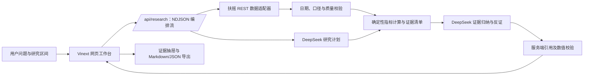

# 市场证据台：项目现状与迭代路线图

更新时间：2026-10-19（北京时间）

## 当前结论：研究主流程能跑通

研究主流程目前可以跑通。2026-10-19 从公开 URL 匿名提交 20 个交易日的上证研究后，页面以 live 模式读取扶摇交易日历、指数日线和对比指数，代码计算指标，DeepSeek 计划与报告均成功，研究流以 `done=complete` 结束。实际行情截止 2026-10-16，覆盖区间为 2026-09-10 至 2026-10-16，报告证据覆盖率 67%。本次全市场快照被判为过期，市场宽度为 stale，因此系统明确表示无法判断指数走势与市场参与度是否一致；估值、情绪和事件也仍缺失。这是“核心路径跑通、数据覆盖不完整”，不是七维研究全部完成。可从“近20个交易日上证指数的走势与市场参与度是否一致？”开始演示。

这代表核心研究 MVP 可用，不代表七个证据维度都已接通。当前已能研究指数走势、市场宽度、大小盘风格和成交额；估值、情绪、重要事件会明确显示缺口，不会用演示值冒充真实数据。历史日期可查指数日线，但当前全市场快照不能补成历史市场宽度。

## 已完成

- Vinext 网页工作台、研究问题与日期区间输入、实时 NDJSON 研究进度。
- 扶摇真实指数行情、交易日历和最新全市场行情快照；支持上证、深证成指、创业板、沪深 300、中证 1000。
- 代码计算区间收益、均线、回撤、波动、市场宽度、风格差和成交额比值。
- 证据抽屉显示数据来源、时点、字段、口径和公式；支持 Markdown／JSON 导出与多轮追问。
- DeepSeek 生成研究计划和归纳、反证、不确定性；服务端校验报告字段、证据引用和数值支持。
- 缺数、过期、接口失败和历史宽度不可用均保留明确状态。供应商密钥只保存在服务端运行时配置。

## 尚未完成与数据缺口

| 维度／能力 | 当前状态 | 需要补齐 |
| --- | --- | --- |
| 估值 | 未接入 | 扶摇已验证的是个股最新估值快照；还缺指数 PE/PB 映射与可靠历史序列，不能报告指数估值分位。 |
| 情绪 | 未接入 | 扶摇有可查询的涨跌停等情绪数据，但尚未接入应用，也未完成统计口径和页面验证。 |
| 重要事件 | 未接入 | 平台新闻库约 65.5 万条，最新发布时间为 2026-10-01；最近 7 天没有新入库记录。近 30 天样本中只有约 5% 有原文链接。雪球摘要虽于 10-18 抓取，最新文章发布时间停在 09-20。恢复新闻采集、补齐来源链接和新鲜度后，才能筛选当前重大事件。 |
| 市场宽度／历史宽度 | 当前公开实测为 stale；不可回填 | 10-19 公开研究中最新快照被识别为过期，宽度不可用；扶摇当前全市场接口只提供最新快照，历史区间不能补成逐日宽度。恢复稳定新鲜快照后再作为可用维度。 |
| iFinD | 未连接 | 当前 MCP 鉴权未通过；同花顺资讯事件检索属于客户端专用能力，不是可直接供本应用调用的公开 REST/MCP/CLI 接口。 |
| 数据授权与双源验证 | 待确认 | 需确认页面及导出展示许可；第二数据源接入后验证冲突提示和口径对齐。 |

重大事件筛选应以发布时间和研究截止日为准，优先保留可信来源、影响范围明确、具有市场或行业重要性、可交叉印证且带原文链接的事件；先去重再排序。事件事实与“可能影响”分开呈现，后者明确标注为分析推断。

## 人与 AI 各自做了什么

- **人负责**：提出产品目标与研究边界，提供并配置数据/模型凭据，选择部署环境，决定研究问题，并核验真实数据、展示口径和结果是否可用。投资判断与后续行动仍由人负责。
- **程序负责**：请求数据源、按固定公式计算指标、处理日期和数据质量状态、保留来源链路，并拦截缺少证据支持的报告数值。
- **DeepSeek 负责**：在允许的范围内选择本轮研究角度，并依据已计算的证据组织摘要、观察、反证、不确定性和重新评估条件。它不替代数据源，也不应凭空补数据。

## 总体架构

浏览器只提交研究问题和范围；供应商密钥留在服务端。扶摇提供原始市场数据，程序计算事实指标，DeepSeek 负责受证据约束的归纳，页面同时呈现结论、证据和数据缺口。

## 后续迭代顺序

1. **确认公开使用边界**：确认扶摇数据的页面展示和导出许可；公开访客会使用服务端配置的上游额度，当前还没有登录或请求限流，后续按实际分享范围决定是否增加访问控制。
2. **恢复新闻新鲜度**：查清 `portal_news_items` 上游采集任务，恢复日常入库；要求发布时间、来源、可访问原文链接、正文/摘要和关联实体齐全，再实现重大事件去重与排序。
3. **补齐研究维度**：先接入涨跌停情绪数据；随后评估指数估值来源与历史覆盖，缺少可靠序列时不计算分位。
4. **补历史和交叉校验**：为历史区间建立逐日宽度数据；接入第二来源后验证同字段冲突、时点差异和口径差异，并持续保留匿名真实研究回归。

## 公开入口

- Web：[市场证据台](https://market-evidence-desk-20261018.minty-genet-8078.chatgpt.site)。2026-10-19 已匿名验证 live health 和一轮真实研究，结果 `done=complete`。
- Git：[GitHub 仓库](https://github.com/PatreIsreal/market-evidence-mvp)。
- 自托管：服务器 VPN 内运行，默认端口 3180；具体地址不在公开文档中披露。

公开站点可直接发起扶摇和 DeepSeek 请求，会消耗服务端账户的上游额度；当前没有登录或请求限流。分享链接时应考虑这一点。

详细指标口径、测试记录和部署说明见 [方法说明](methodology.md)、[数据能力清单](data-capabilities.md)、[测试说明](testing.md) 与 [自托管部署](self-hosted-deployment.md)。
