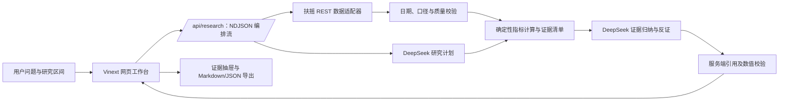

# 市场证据台：项目现状与迭代路线图

更新时间：2026-10-19（北京时间）

## 当前结论：取数链路能跑通，最新完整主链路复测未通过

2026-10-19 17:10—17:12 对公开 Web 做了两次真实端到端研究：扶摇研究计划、实时数据、21 条证据、10 条事件候选和复核条件均成功；DeepSeek 最终报告两次都未通过结构校验，AI 结论和结论证据强度未生成。因此当前结论是“取数链路可运行，完整主链路未通过”，应先修复模型报告校验并重新跑通，再按完整 MVP 验收。此前一次成功研究的记录是历史结果，不能覆盖本次复测。详见[端到端测试记录](e2e-test-2026-10-19.md)。

即使取数链路成功，七个证据维度也未全部接通。应用可读取涨停统计和近 72 小时 A 股快讯候选；情绪只是盘面代理，快讯尚未经过重要性或多源核验，且事件记录未持续写入历史库。估值仍缺指数口径和历史分位；当前全市场快照不能补成历史市场宽度。自托管服务需另行升级并复测。

## 已完成

- Vinext 网页工作台、研究问题与日期区间输入、实时 NDJSON 研究进度。
- 扶摇真实指数行情、交易日历和最新全市场行情快照；支持上证、深证成指、创业板、沪深 300、中证 1000。
- 代码计算区间收益、均线、回撤、波动、市场宽度、风格差和成交额比值。
- 证据抽屉显示数据来源、时点、字段、口径和公式；支持 Markdown／JSON 导出与多轮追问。
- DeepSeek 生成研究计划和归纳、反证、不确定性；服务端校验报告字段、证据引用和数值支持。
- 本地新增扶摇涨停统计与 A 股快讯候选；事件摘要可追溯到上游记录、时间和 HTTPS 原文入口，历史研究不混入当前资讯。
- 缺数、过期、接口失败和历史宽度不可用均保留明确状态。供应商密钥只保存在服务端运行时配置。

## 尚未完成与数据缺口

| 维度／能力 | 当前状态 | 需要补齐 |
| --- | --- | --- |
| 估值 | 未接入 | 扶摇已验证的是个股最新估值快照；还缺指数 PE/PB 映射与可靠历史序列，不能报告指数估值分位。 |
| 情绪 | 本地已接涨停统计 | 按研究收盘日获取涨停/打开家数、供应商封板率和最高连板；历史序列未保存，且仅是盘面代理。 |
| 重要事件 | 可读取近 72 小时快讯候选；没有应用内历史沉淀 | 当前研究可取 10 条候选，但应用没有事件历史表或每日采集任务。旧服务器新闻库近期入库不新，尚未接入应用；还需有授权的历史来源、持续采集、交叉来源、重要性排序和展示许可确认。 |
| 市场宽度／历史宽度 | 当前公开实测为 stale；不可回填 | 10-19 公开研究中最新快照被识别为过期，宽度不可用；扶摇当前全市场接口只提供最新快照，历史区间不能补成逐日宽度。恢复稳定新鲜快照后再作为可用维度。 |
| iFinD | 未连接 | 当前 MCP 鉴权未通过；同花顺资讯事件检索属于客户端专用能力，不是可直接供本应用调用的公开 REST/MCP/CLI 接口。 |
| 数据授权与双源验证 | 待确认 | 需确认页面及导出展示许可；第二数据源接入后验证冲突提示和口径对齐。 |

重大事件筛选应以发布时间和研究截止日为准，优先保留可信来源、影响范围明确、具有市场或行业重要性、可交叉印证且带原文链接的事件；先去重再排序。事件事实与“可能影响”分开呈现，后者明确标注为分析推断。

## 人与 AI 各自做了什么

- **人负责**：提出产品目标与研究边界，提供并配置数据/模型凭据，选择部署环境，决定研究问题，并核验真实数据、展示口径和结果是否可用。投资判断与后续行动仍由人负责。
- **程序负责**：请求数据源、按固定公式计算指标、处理日期和数据质量状态、保留来源链路，并拦截缺少证据支持的报告数值。
- **DeepSeek 负责**：在允许的范围内选择本轮研究角度，并依据已计算的证据组织摘要、观察、反证、不确定性和重新评估条件。它不替代数据源，也不应凭空补数据。

## 总体架构

浏览器只提交研究问题和范围；供应商密钥留在服务端。扶摇提供原始市场数据，程序计算事实指标，DeepSeek 负责受证据约束的归纳，页面同时呈现结论、证据和数据缺口。

## 后续迭代顺序

1. **修复 DeepSeek 最终报告结构校验**：查明公开运行时模型返回与报告 schema 不匹配的具体字段，修正后重跑浏览器端到端流程。
2. **更新自托管服务器**：部署已验证版本，并在服务器真实研究流回归。
3. **补齐历史序列与估值**：每日保存市场宽度／成交额聚合；评估指数估值来源与历史覆盖，缺少可靠序列时不计算分位。
4. **建立历史事件沉淀**：先确认存储和展示授权，再创建事件表与收盘后采集任务；没有获准历史接口就从启动日开始累积，禁止用当前快讯回填。
5. **提高事件可信度及双源验证**：加入第二来源交叉核验并确认原文展示许可；接入第二行情源后验证冲突、时点和口径差异。

## 公开入口

- Web：[市场证据台](https://market-evidence-desk-20261018.minty-genet-8078.chatgpt.site)。2026-10-19 已匿名验证 live health 和一轮真实研究，结果 `done=complete`。
- Git：[GitHub 仓库](https://github.com/PatreIsreal/market-evidence-mvp)。
- 自托管：服务器 VPN 内运行，默认端口 3180；具体地址不在公开文档中披露。

公开站点可直接发起扶摇和 DeepSeek 请求，会消耗服务端账户的上游额度；当前没有登录或请求限流。分享链接时应考虑这一点。

详细指标口径、测试记录和部署说明见 [方法说明](methodology.md)、[数据能力清单](data-capabilities.md)、[测试说明](testing.md) 与 [自托管部署](self-hosted-deployment.md)。
